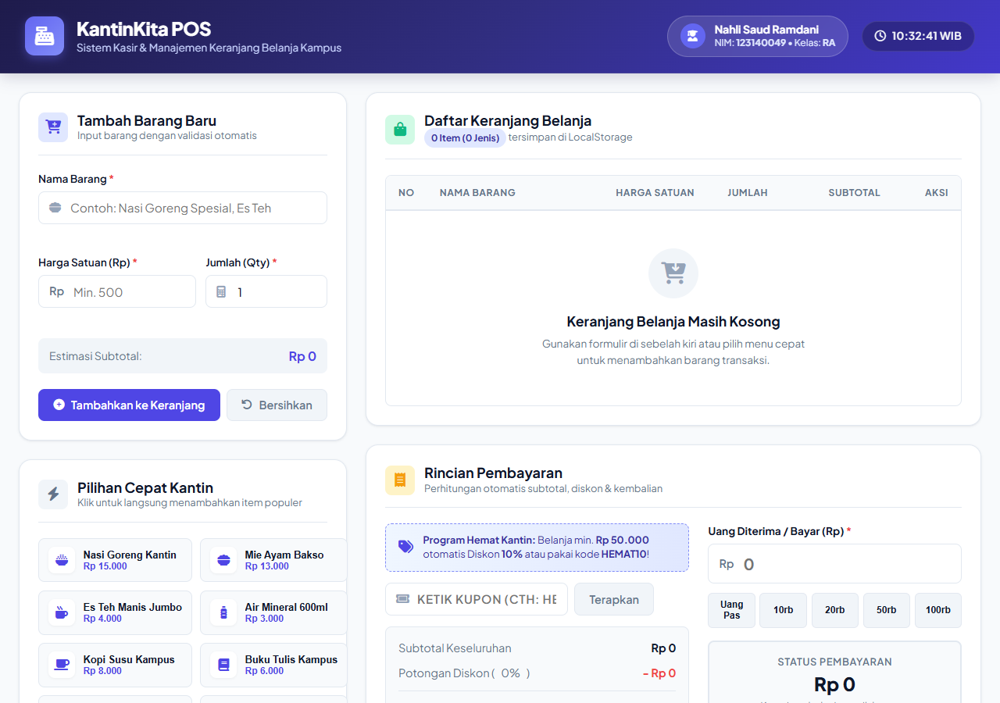
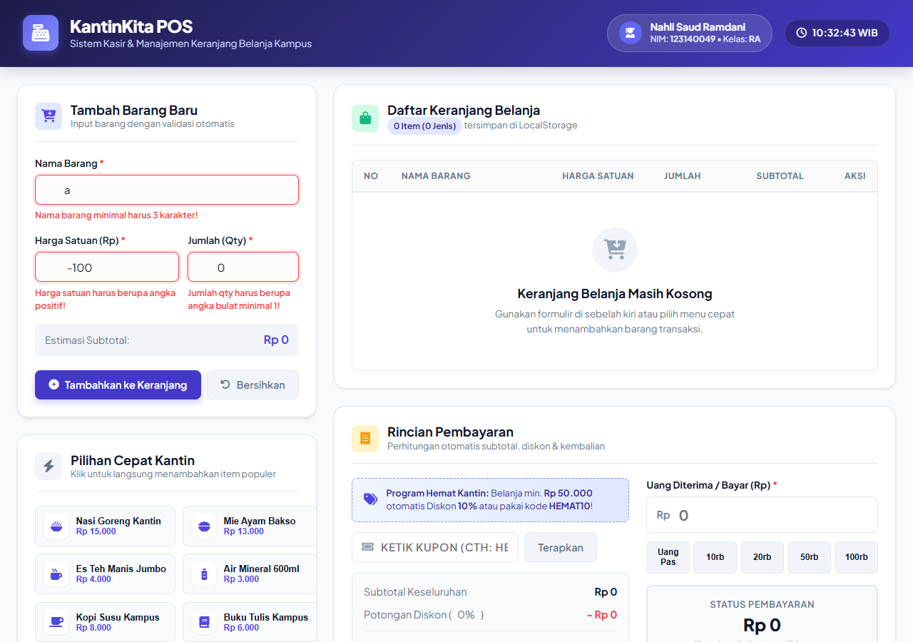
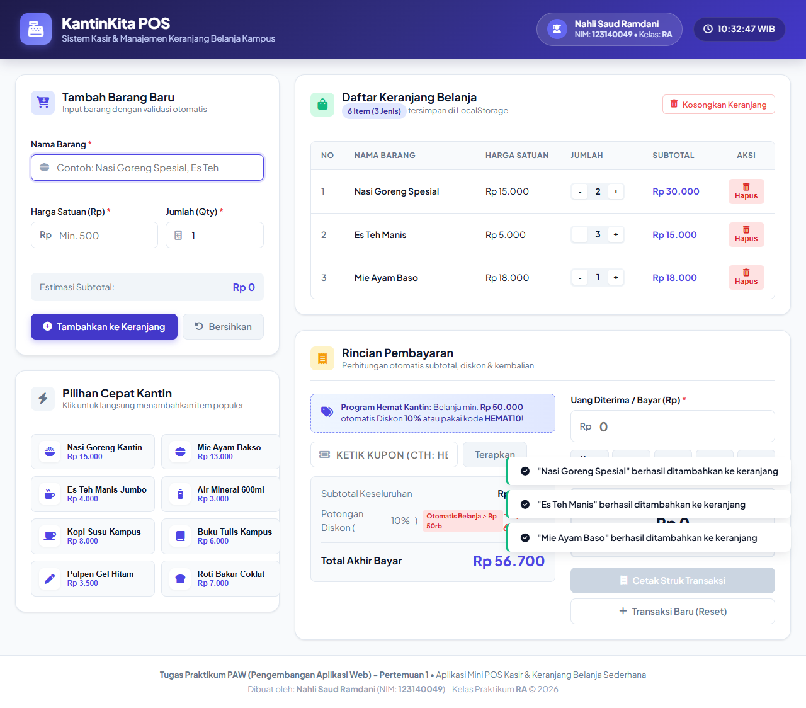
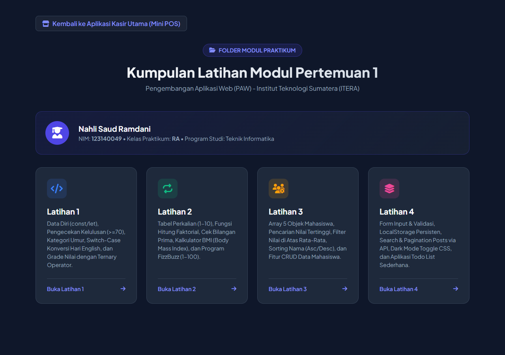

# Tugas Praktikum Pengembangan Aplikasi Web (PAW) - Pertemuan 1
## Aplikasi Kasir & Keranjang Belanja Sederhana (Mini POS Kantin Kampus)

Aplikasi Web **Mini Point of Sale (POS)** dan Manajemen Keranjang Belanja sederhana yang dirancang untuk kasir kantin / toko kampus. Aplikasi ini mengintegrasikan tiga kompetensi dasar pemrograman web berbasis Vanilla HTML, CSS, dan JavaScript murni: **validasi formulir interaktif**, **kalkulasi perhitungan otomatis**, dan **manajemen state keranjang belanja persisten dengan Web Storage API (`localStorage`)**.

---

### Data Mahasiswa
- **Nama** : Nahli Saud Ramdani
- **NIM** : 123140049
- **Kelas Praktikum** : RA
- **Mata Kuliah** : Pengembangan Aplikasi Web (PAW)

---

### Fitur & Implementasi Kebutuhan Tugas

#### 1. Validasi Form Input Barang
- **Nama Barang**:
  - Wajib diisi.
  - Minimal 3 karakter (contoh: "Buku Tulis", "Air Mineral").
- **Harga Satuan**:
  - Wajib berupa angka positif.
  - Minimal bernilai **Rp 500** (tidak boleh 0, bernilai negatif, atau teks kosong).
- **Jumlah / Qty**:
  - Wajib berupa angka bulat (integer) minimal **1**.
- **Feedback Validasi**:
  - Jika input tidak valid, sistem menampilkan pesan error teks berwarna merah di bawah kolom input terkait serta memberikan aksentuasi border merah (dengan animasi *shake* halus).
  - Mencegah barang masuk ke keranjang belanja jika masih ada input yang salah.
  - Jika data valid dan berhasil disubmit, form otomatis di-reset bersih untuk entri transaksi berikutnya.
  - Dilengkapi *Live Subtotal Preview* di bawah form saat kasir mengetik harga dan jumlah.

#### 2. Modul Kalkulator & Perhitungan Otomatis
- **Kalkulasi Subtotal per Item**:
  $$\text{Subtotal} = \text{Harga Satuan} \times \text{Qty}$$
- **Kalkulasi Total Belanja**:
  - Menjumlahkan seluruh subtotal barang yang ada di keranjang belanja secara otomatis.
- **Kalkulator Diskon Sederhana**:
  - Memberikan diskon **10%** otomatis jika total belanja mencapai minimal **Rp 50.000**.
  - Atau dapat menggunakan kode kupon promo: `HEMAT10`.
  - Menampilkan nominal potongan diskon dan total akhir yang harus dibayar.
- **Kalkulator Pembayaran & Kembalian**:
  - Terdapat input "Uang Bayar" beserta tombol cepat nominal uang (*Uang Pas, 10rb, 20rb, 50rb, 100rb*).
  - Sistem menghitung kembalian otomatis:
    $$\text{Kembalian} = \text{Uang Bayar} - \text{Total Akhir}$$
  - Jika uang bayar kurang, sistem menampilkan status peringatan merah bahwa uang belum mencukupi beserta nominal kekurangannya.
  - Jika uang pas atau berlebih, tombol "Cetak Struk Transaksi" menjadi aktif.

#### 3. Manajemen List Keranjang & LocalStorage
- **Tabel Keranjang Belanja**:
  - Menampilkan kolom: **No**, **Nama Barang**, **Harga Satuan**, **Qty** (lengkap dengan kontrol tombol `+` dan `-`), **Subtotal**, dan **Aksi**.
- **Aksi Hapus Item**:
  - Terdapat tombol **Hapus** pada setiap baris item keranjang.
  - Setelah dihapus, total belanja, diskon, dan kembalian langsung dihitung ulang otomatis.
- **Penyimpanan Persisten (LocalStorage)**:
  - Menyimpan data keranjang belanja menggunakan `localStorage.setItem()` dengan serialisasi `JSON.stringify()`.
  - Memuat kembali data saat halaman dimuat ulang (*refresh*) menggunakan `JSON.parse()`.
  - Data keranjang tidak hilang meskipun browser ditutup atau di-refresh.
- **Tombol Transaksi Baru / Reset**:
  - Menyediakan tombol untuk mengosongkan seluruh keranjang belanja dan membersihkan data di `localStorage`.

#### 4. Fitur Tambahan (Bonus UI/UX)
- **Pilihan Cepat Menu Kantin (Quick Preset Items)**: Tombol sekali klik untuk menu populer kantin (Nasi Goreng, Es Teh, Mie Ayam, Buku Tulis, dll).
- **Modal Struk Thermal Receipt & Print Support**: Menampilkan struk kasir profesional dengan identitas kasir (Nahli Saud Ramdani - 123140049 - RA) yang dapat langsung dicetak (`window.print()`).
- **Live Digital Clock**: Penunjuk waktu WIB secara *real-time*.
- **Toast Notifications**: Notifikasi mengambang saat aksi berhasil atau dibatalkan.

---

### Struktur Berkas Proyek

```plaintext
NahliSaudRamdani_123140049_pertemuan1/
├── index.html        # Struktur antarmuka web semantik & terstruktur (Aplikasi Utama POS)
├── style.css         # Desain tampilan modern, responsif, dan efek print receipt
├── script.js         # Logika JavaScript murni (DOM, validasi, kalkulator, localStorage)
├── README.md         # Dokumentasi lengkap tugas praktikum
├── modul/            # Folder Latihan Praktikum Pertemuan 1
│   ├── index.html    # Menu utama / Dashboard navigasi seluruh modul latihan
│   ├── latihan1.html # Latihan 1: Data diri, Kelulusan, Umur, Switch Hari, Ternary Grade
│   ├── latihan1.js
│   ├── latihan2.html # Latihan 2: Tabel Perkalian, Faktorial, Prima, BMI, FizzBuzz
│   ├── latihan2.js
│   ├── latihan3.html # Latihan 3: Array Objek Mahasiswa, Highest, Filter, Sort, CRUD
│   ├── latihan3.js
│   ├── latihan4.html # Latihan 4: Validasi Form, LocalStorage, API Search/Pagination, Dark Mode, Todo List
│   └── latihan4.js
└── screenshots/      # Tangkapan Layar (Screenshot) Hasil Eksekusi Aplikasi
    ├── 1_tampilan_form_input_utama.png
    ├── 2_tampilan_validasi_error.png
    ├── 3_hasil_kalkulator_dan_tabel_riwayat.png
    └── 4_tampilan_folder_modul.png
```

---

### Cara Menjalankan Aplikasi & Modul Latihan
1. **Aplikasi Utama (Mini POS)**: Buka berkas `index.html` di browser web.
2. **Modul Latihan (Latihan 1-4)**: Buka berkas `modul/index.html` untuk mengakses seluruh latihan praktikum secara interaktif.
3. **Tangkapan Layar**: Seluruh tangkapan layar pengujian telah tersimpan rapi di folder `screenshots/`.

---

### Tangkapan Layar (Screenshots) Aplikasi

#### 1. Tampilan Form Input Utama


---

#### 2. Tampilan Saat Validasi Error Muncul


---

#### 3. Tampilan Hasil Perhitungan Kalkulator & Tabel Riwayat Data


---

#### 4. Tampilan Dashboard Folder Modul (Latihan 1 - 4)


