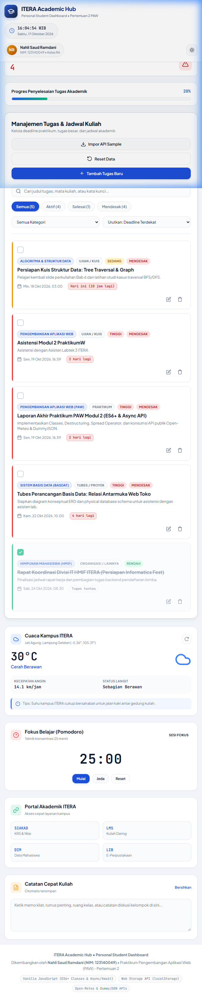
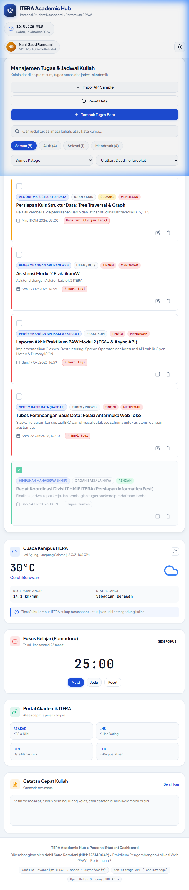
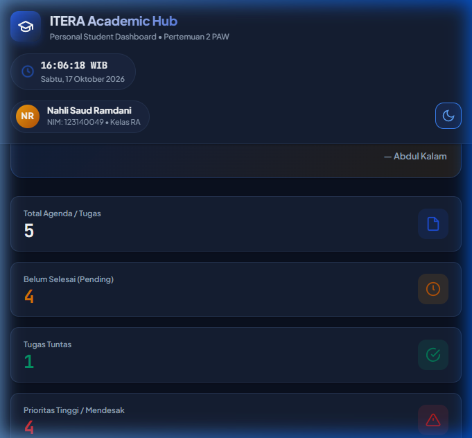
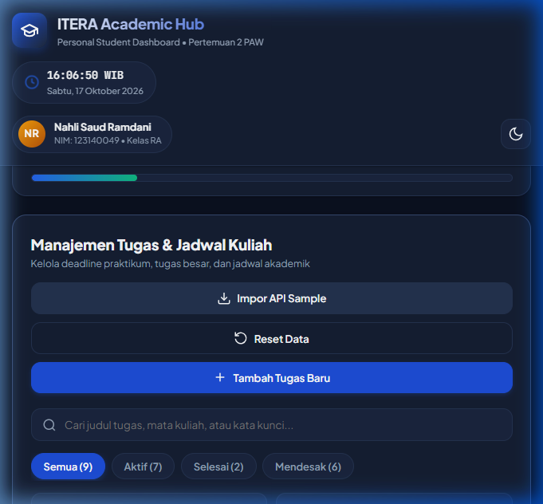
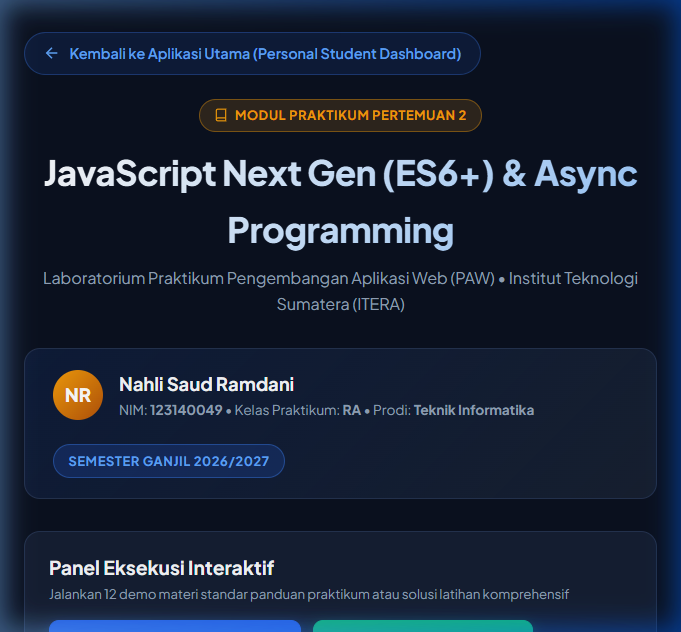
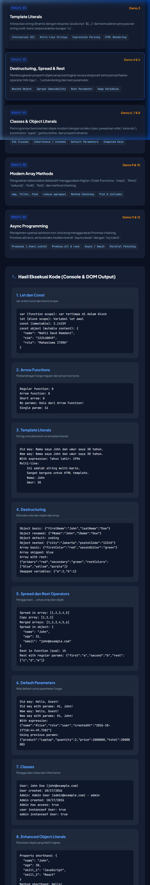
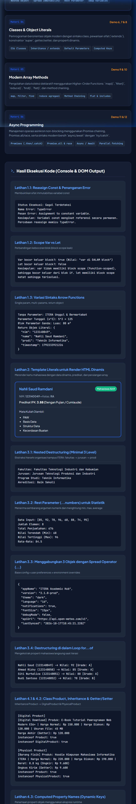
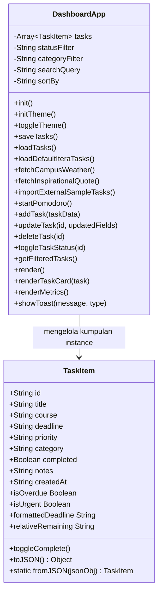

# Tugas Praktikum Pengembangan Aplikasi Web (PAW) - Pertemuan 2
## ITERA Academic Hub: Personal Student Dashboard

Aplikasi Web **Personal Student Dashboard** interaktif yang dirancang khusus untuk memfasilitasi kebutuhan produktivitas akademik harian mahasiswa **Institut Teknologi Sumatera (ITERA)**. Aplikasi ini dibangun menggunakan standar modern **Vanilla JavaScript (ES6+ Object-Oriented Programming)**, penyimpanan lokal persisten melalui **Web Storage API (`localStorage`)**, serta konsumsi **API Publik Real-time Asinkron** (*Open-Meteo Weather*, *DummyJSON Quotes*, dan *JSONPlaceholder Todos*).

---

### Data Mahasiswa
- **Nama** : Nahli Saud Ramdani
- **NIM** : 123140049
- **Kelas Praktikum** : RA
- **Program Studi** : Teknik Informatika
- **Mata Kuliah** : Praktikum Pengembangan Aplikasi Web (PAW)
- **Institusi** : Institut Teknologi Sumatera (ITERA)

---

### Daftar Isi
1. [Latar Belakang & Tantangan Kreatif](#latar-belakang--tantangan-kreatif)
2. [Fitur-Fitur Utama Aplikasi](#fitur-fitur-utama-aplikasi)
3. [Tangkapan Layar Antarmuka Aplikasi](#tangkapan-layar-antarmuka-aplikasi)
4. [Pemetaan Implementasi Fitur ES6+](#pemetaan-implementasi-fitur-es6)
5. [Arsitektur Kode & Desain Berorientasi Objek](#arsitektur-kode--desain-berorientasi-objek)
6. [Integrasi API Publik Real-time](#integrasi-api-publik-real-time)
7. [Struktur Berkas Proyek](#struktur-berkas-proyek)
8. [Panduan Menjalankan Aplikasi](#panduan-menjalankan-aplikasi)

---

### Latar Belakang & Tantangan Kreatif

Sebagai mahasiswa Teknik Informatika di ITERA, dinamika perkuliahan diiringi oleh banyaknya beban praktikum di Laboratorium Teknik (Labtek), tugas besar (*tubes*), kuis berkala, dan aktivitas kemahasiswaan. Kendala utama yang sering dihadapi adalah:
1. **Lupa Batas Waktu (*Deadline*)**: Sulit memantau prioritas tugas mana yang paling mendesak di antara berbagai modul kuliah.
2. **Kondisi Cuaca Kampus ITERA**: Kampus ITERA yang berlokasi di Jati Agung, Lampung Selatan memiliki area terbuka yang luas antar gedung kuliah (Labtek 1, 2, 3, Gedung Kuliah Umum). Perubahan cuaca mendadak (panas terik atau hujan deras) sangat mempengaruhi mobilitas mahasiswa.
3. **Manajemen Fokus Belajar**: Mahasiswa membutuhkan teknik fokus (seperti *Pomodoro Technique*) untuk menyelesaikan modul praktikum dan belajar mandiri tanpa distraksi.

Aplikasi **ITERA Academic Hub** hadir menjawab kebutuhan spesifik tersebut ke dalam satu dasbor terpadu yang ringan, cepat, dan bekerja tanpa dependensi *framework* pihak ketiga yang berat.

---

### Fitur-Fitur Utama Aplikasi

#### 1. Manajemen Tugas Akademik Interaktif (Full CRUD)
- **Tambah Tugas Baru (Create)**: Formulir modal responsif dengan validasi interaktif. Pengguna memasukkan judul tugas, mata kuliah, kategori kegiatan, batas waktu (*datetime picker*), prioritas, dan catatan tambahan.
- **Daftar Tugas Real-time (Read)**: Menampilkan kartu tugas terstruktur lengkap dengan lencana kategori, lencana mata kuliah, indikator tingkat prioritas, dan hitung mundur sisa waktu relatif (*countdown*).
- **Edit Tugas (Update)**: Mengubah detail tugas secara langsung melalui modal yang otomatis terisi dengan data yang sudah ada.
- **Hapus Tugas (Delete)**: Dilengkapi modal konfirmasi keamanan sebelum data dihapus secara permanen untuk mencegah ketidaksengajaan.
- **Tandai Selesai (Toggle Status)**: Checkbox interaktif untuk mencentang tugas yang sudah selesai dengan efek visual *strikethrough* dan pembaruan metrik otomatis.

#### 2. Penyimpanan Lokal Persisten (`localStorage`)
- Seluruh tugas disimpan secara otomatis dalam serialisasi JSON `localStorage.setItem('itera_dashboard_tasks_v1', ...)`.
- Preferensi tema (Mode Terang / Gelap) tersimpan persisten.
- Catatan kilat (*Scratchpad*) tersimpan otomatis setiap kali pengguna mengetik (*auto-save*).
- Data tetap aman dan utuh saat halaman ditutup atau di-refresh oleh pengguna.

#### 3. Pemantauan Cuaca Real-time Kampus ITERA (Async Open-Meteo API)
- Mengonsumsi endpoint satelit cuaca **Open-Meteo** langsung pada koordinat kampus ITERA (Latitude: `-5.36`, Longitude: `105.31`).
- Menampilkan suhu (°C), kecepatan angin (km/jam), status awan/hujan berdasarkan standar kode WMO, ilustrasi vektor cuaca, serta **tips mobilitas kampus** (misal: pengingat sedia payung jika gerimis di ITERA).

#### 4. Kutipan Motivasi Belajar Harian (Async DummyJSON API)
- Mengambil kutipan inspiratif acak dari **DummyJSON Quotes API** secara asinkron untuk menyemangati mahasiswa dalam belajar. Dilengkapi tombol *refresh* acak kutipan kapan saja.

#### 5. Simulasi Impor Tugas Eksternal (Async JSONPlaceholder API)
- Fitur sinkronisasi data cloud untuk mengimpor daftar *todos* dari **JSONPlaceholder API** dan mentransformasikannya secara otomatis ke dalam format `TaskItem` instan.

#### 6. Pencarian, Pemfilteran, dan Pengurutan Cepat
- **Pencarian Real-time**: Menemukan tugas berdasarkan kata kunci judul, nama matakuliah, atau catatan.
- **Tab Filter Status**: Memfilter antara Semua Tugas, Tugas Aktif, Tugas Selesai, dan Tugas Mendesak (< 24 Jam atau Prioritas Tinggi).
- **Dropdown Filter Kategori**: Praktikum, Tugas Kuliah, Tubes / Proyek, Ujian / Kuis, Organisasi.
- **Pengurutan (Sort)**: Berdasarkan deadline terdekat, deadline terlama, prioritas tertinggi, atau tanggal dibuat.

#### 7. Widget Tambahan Mahasiswa
- **Jam Digital Kampus (WIB)**: Penunjuk waktu lokal Indonesia Barat secara *real-time* dengan tanggal format Bahasa Indonesia.
- **Focus Timer Pomodoro (25 Menit)**: Timer belajar mandiri dengan kendali Mulai, Jeda, dan Reset.
- **Catatan Kilat (Quick Scratchpad)**: Area memo cepat untuk mencatat rumus, ruang kuliah, atau tautan penting.
- **Pintasan Cepat Portal ITERA**: Tautan langsung ke SIAKAD, LMS Kuliah Daring, DIM, dan E-Perpustakaan ITERA.
- **Bilah Progres Akademik**: Persentase dinamis dari rasio tugas yang sudah diselesaikan dibanding total agenda.
- **Dual Theme Support**: Mode terang bertema kampus elegan dan mode gelap modern berlatar *deep navy*.

---

### Tangkapan Layar Antarmuka Aplikasi

Berikut adalah dokumentasi hasil tangkapan layar saat aplikasi dijalankan dan diuji:

#### 1. Tampilan Utama Dashboard (Mode Terang)

*Gambar 1: Antarmuka utama menampilkan widget cuaca kampus ITERA, kutipan motivasi, metrik ringkasan tugas, timer pomodoro, dan daftar tugas akademik.*

#### 2. Formulir Modal Tambah / Edit Tugas

*Gambar 2: Modal dialog interaktif penambahan tugas baru dengan validasi kolom wajib, pemilih batas waktu, kategori kuliah, dan tingkat prioritas.*

#### 3. Tampilan Dashboard (Mode Gelap / Dark Mode)

*Gambar 3: Antarmuka dalam tema gelap (Dark Theme) dengan kontras tinggi, aksen warna ITERA, dan toast notifikasi aksi pengguna.*

#### 4. Integrasi Async Import API Eksternal (JSONPlaceholder)

*Gambar 4: Demonstrasi pemanggilan fungsi asinkron (fetch) ke JSONPlaceholder API untuk mengimpor dan menggabungkan tugas eksternal secara dinamis.*

#### 5. Antarmuka Modul Praktikum (Runner 12 Demo & Solusi Latihan)

*Gambar 5: Tampilan halaman modul interaktif dengan kartu materi dan panel kontrol eksekusi.*

#### 6. Hasil Eksekusi 12 Demo Materi Standar

*Gambar 6: Output komparasi 12 materi ES6+ (Let/Const, Arrow Function, Template Literals, Destructuring, Spread/Rest, Class, dan Async).*

#### 7. Hasil Eksekusi Solusi Latihan Mandiri

*Gambar 7: Output eksekusi seluruh soal latihan mandiri (Nested destructuring, Rest parameter stats, Class inheritance, groupBy, dan Async retry).*

---

### Pemetaan Implementasi Fitur ES6+

Berikut adalah tabel pembuktian implementasi fitur-fitur modern ECMAScript 6+ pada berkas [`app.js`](file:///d:/S7.1/MKS7/Praktikum%20PAW/NahliSaudRamdani_123140049_pertemuan2/app.js):

| No | Fitur ES6+ | Lokasi Baris Kode di `app.js` | Penjelasan & Contoh Kode Singkat |
|:---:|:---|:---|:---|
| 1 | **Deklarasi `let` dan `const`** | Baris `23`, `49-50`, `62`, `151-153`, `288`, `294-295`, `345-363`, `468`, `478`, `749-750`, `822-828`, `920-924`, `1006-1011`, `1089` | Menggunakan `const` untuk nilai konstan, URL API, instansiasi, serta elemen DOM, dan `let` untuk variabel yang nilainya mengalami mutasi (misal filter hasil `let result`). **Nol penggunaan kata kunci usang `var`**. |
| 2 | **Arrow Functions (`=>`)** | Baris `293` (`toggleTheme`), `414` (`saveNotes`), `422` (`clearNotes`), `436` (`updateTime`), `601` (`data.map`), `633` (`startPomodoro`), `653` (`pausePomodoro`), `662` (`resetPomodoro`), `702` (`tasks.map`), `722` (`tasks.filter`), `731` (`toggleTaskStatus`), `754-773` (`filter`), `777` (`sort`), `807` (`renderTaskCard`), `956` (`openAddModal`), `973` (`openEditModal`), `1003` (`handleFormSubmit`), `1062` (`openDeleteModal`), `1134-1243` | Digunakan secara konsisten untuk metode kelas, callback array (`map`, `filter`, `sort`), interval waktu, serta pendengar event (*event listeners*). |
| 3 | **Template Literals (`` `...` ``)** | Baris `23`, `102-106`, `299`, `442`, `488`, `517-545`, `557-560`, `571-574`, `606-613`, `674`, `832-897`, `933-934`, `1067`, `1101-1104` | Menggantikan penggabungan string konvensional dengan *string interpolation* `${...}` untuk pembuatan markup HTML kartu tugas dinamis, teks waktu jam, teks cuaca, teks kutipan, dan notifikasi toast. |
| 4 | **Fungsi Asinkron (Async / Await & Promises)** | Baris `268-280` (`async init` & `Promise.allSettled`), Baris `467-506` (`async fetchCampusWeather`), Baris `553-583` (`async fetchInspirationalQuote`), Baris `589-626` (`async importExternalSampleTasks`) | Menjalankan pemanggilan HTTP GET API publik non-blocking menggunakan `async/await` dengan blok pengaman `try...catch` dan penyediaan data cadangan (*graceful fallback*). |
| 5 | **Implementasi Classes (OOP)** | Baris `18-140` (`class TaskItem`), Baris `148-1236` (`class DashboardApp`) | Menerapkan arsitektur Object-Oriented modern dengan enkapsulasi properti, *constructor*, *getter properties* (`isOverdue`, `isUrgent`, `formattedDeadline`, `relativeRemaining`), *instance methods*, dan *static factory method* (`TaskItem.fromJSON()`). |
| 6 | **Destructuring Assignment** | Baris `22-32` (Parameter Destructuring di `TaskItem`), Baris `481-482` (`const { current_weather } = data; const { temperature, windspeed, weathercode } = current_weather;`), Baris `568` (`const { quote, author } = data;`), Baris `601` (`({ title, completed }, index) => ...`), Baris `807-820` (Parameter Destructuring di `renderTaskCard`) | Mengekstrak properti objek secara langsung pada parameter fungsi maupun hasil penguraian respon JSON API publik. |
| 7 | **Spread Operator (`...`)** | Baris `617` (`[...newTasks, ...this.tasks]`), Baris `690` (`[newTask, ...this.tasks]`), Baris `706` (`{ ...task.toJSON(), ...updatedFields }`), Baris `722` (`[...this.tasks.filter(...)]`), Baris `734` (`{ ...task.toJSON(), completed: !task.completed }`), Baris `750` (`[...this.tasks]`) | Menjaga prinsip **immutability** pada state array saat menambah data baru di urutan teratas, memperbarui item tertentu, maupun menghapus item. |
| 8 | **Default Parameters** | Baris `23-31` (Nilai bawaan parameter `TaskItem`), Baris `1088` (`type = 'info'` pada `showToast`) | Memberikan nilai cadangan default pada argumen konstruktor dan fungsi. |

---

### Arsitektur Kode & Desain Berorientasi Objek

Aplikasi dirancang dengan pemisahan tugas yang jelas (*Separation of Concerns*) berbasis OOP:



1. **`TaskItem` (Model Data)**:
   - Merepresentasikan entitas tunggal tugas akademik.
   - Mengenkapsulasi kalkulasi waktu relatif, pengecekan tanggal terlewat, dan format tanggal lokal.
   - Menyediakan fungsi serialisasi dan deserialisasi JSON dua arah.
2. **`DashboardApp` (State & Controller)**:
   - Mengelola siklus hidup aplikasi, sinkronisasi `localStorage`, perenderan dinamis via Template Literals, dan pendengar event DOM.
   - Mengisolasi logika pengambilan data publik asinkron secara mandiri.

---

### Integrasi API Publik Real-time

Aplikasi mengintegrasikan tiga API publik resmi tanpa memerlukan kunci API (API Key) privat:

1. **Open-Meteo Weather API**:
   - URL: `https://api.open-meteo.com/v1/forecast?latitude=-5.36&longitude=105.31&current_weather=true`
   - Fungsi: Menampilkan cuaca aktual kampus ITERA di Lampung Selatan berdasarkan koordinat geografis presisi.
2. **DummyJSON Quotes API**:
   - URL: `https://dummyjson.com/quotes/random`
   - Fungsi: Mengembalikan kutipan motivasi harian acak untuk memberikan dorongan semangat belajar mahasiswa.
3. **JSONPlaceholder Todos API**:
   - URL: `https://jsonplaceholder.typicode.com/todos?_limit=4`
   - Fungsi: Mensimulasikan pemuatan dan transformasi data tugas eksternal dari cloud ke dalam format model aplikasi lokal.

---

### Struktur Berkas Proyek

```plaintext
NahliSaudRamdani_123140049_pertemuan2/
├── index.html        # Struktur antarmuka semantik (Aplikasi Utama: ITERA Academic Hub Dashboard)
├── style.css         # Desain tampilan modern, responsif, sistem dual-theme (Light & Dark), & glassmorphism
├── app.js            # Logika utama (ES6+ Classes: TaskItem & DashboardApp, Web Storage API, Async Fetch)
├── README.md         # Dokumentasi komprehensif tugas praktikum, pemetaan baris kode ES6+, & modul latihan
├── modul/            # Folder Latihan & Panduan Praktikum Pertemuan 2 (JavaScript Next Gen ES6+)
│   ├── index.html    # Antarmuka Runner Interaktif (12 Demo Materi & Solusi Latihan Lengkap)
│   ├── style.css     # Desain modern dark theme untuk panel eksekusi modul latihan
│   └── js/
│       ├── app.js    # 12 Fungsi Demo Materi Resmi (Let/Const, Arrow, Destructuring, Class, Async, dll)
│       ├── latihan.js# Solusi Lengkap Latihan Mandiri Setiap Topik (Nested destructuring, groupBy, retry, dll)
│       └── main.js   # Script pengikat Runner (addOutput, runAllDemos, runAllLatihan, event listeners)
└── screenshots/      # Dokumentasi visual pengujian aplikasi
    ├── 1_dashboard_light_mode.png
    ├── 2_modal_tambah_tugas.png
    ├── 3_dashboard_dark_mode.png
    └── 4_import_api_sample.png
```

---

### Folder Modul Praktikum: 12 Demo & Solusi Latihan Lengkap

Di dalam folder `modul/`, seluruh materi panduan dan tantangan latihan telah diimplementasikan secara interaktif:

#### 1. Rincian 12 Demo Materi (`modul/js/app.js`):
1. **`demoVariables()`**: Scope `var` (function scope) vs `let`/`const` (block scope), immutabilitas `const`, dan mutasi konten objek.
2. **`demoArrowFunctions()`**: Perbandingan fungsi reguler vs arrow function lengkap, short arrow (implicit return), tanpa parameter, dan parameter tunggal.
3. **`demoTemplateLiterals()`**: Penggabungan string cara lama vs interpolasi `${...}`, string multi-baris, dan evaluasi ekspresi tahun lahir.
4. **`demoDestructuring()`**: Ekstraksi objek dasar, penggantian nama variabel (`firstName: fName`), nilai default (`hobby = "coding"`), nested destructuring, array destructuring, skip element, rest pattern, dan swap variabel kilat `[a, b] = [b, a]`.
5. **`demoSpreadRest()`**: Kloning array, penggabungan array, kloning objek, override properti, dan rest parameter fungsi `sum(...numbers)` & `process(first, second, ...rest)`.
6. **`demoDefaultParams()`**: Perbandingan default parameter modern vs operator OR `||` ES5, parameter berupa ekspresi dinamis, dan referensi parameter sebelumnya.
7. **`demoClasses()`**: Deklarasi `class User`, pewarisan `class Admin extends User`, pemanggilan `super()`, method overriding, dan operator `instanceof`.
8. **`demoObjectLiterals()`**: Property shorthand `{ name, age }`, method shorthand `sayHello()`, dan computed property names `[Date.now()]`.
9. **`demoArrayMethods()`**: Higher-Order Functions `map()`, `filter()`, `find()`, `some()`, `every()`, `reduce()` (sum & mencari data tertua), serta rantai method chaining.
10. **`demoAdvancedArrays()`**: Fitur lanjutan `Array.from()`, `Array.of()`, `flat()`, `flatMap()`, dan `includes()`.
11. **`demoPromises()`**: Promise dasar dengan `resolve`/`reject`, promise chaining bertingkat, `Promise.all()`, dan `Promise.race()`.
12. **`demoAsyncAwait()`**: Pengambilan data tunggal dengan `async/await` dan `try/catch`, serta eksekusi multi-pengguna secara paralel via `Promise.all()`.

#### 2. Rincian Solusi Latihan Mandiri (`modul/js/latihan.js`):
- **Latihan 1 (Variables & Arrow)**: Percobaan reassign `const` tertangkap `TypeError`, pembuktian isolasi blok `let` vs kebocoran `var`, serta 4 variasi arrow functions.
- **Latihan 2 (Template Literals)**: Generator kartu profil mahasiswa HTML dinamis dengan data bersarang, lencana status, dan daftar matakuliah.
- **Latihan 3 (Destructuring & Operators)**:
  - Destructuring objek bertingkat minimal 3 level (Fakultas $\rightarrow$ Jurusan $\rightarrow$ Program Studi).
  - Fungsi `calculateStats(...numbers)` penghitung *count*, *sum*, *min*, *max*, dan *average*.
  - Penggabungan 3 objek dengan Spread Operator (`...`) dan penimpaan properti konfigurasi.
  - Destructuring langsung di dalam iterasi `for (const { nim, name, score } of students)`.
- **Latihan 4 (Classes & Object Literals)**:
  - `class Product` dengan hierarki pewarisan ke `DigitalProduct` (download URL & ukuran file) dan `PhysicalProduct` (berat & ongkos kirim).
  - Implementasi getter `price`, `discount`, `finalPrice`, `shippingCost`, dan setter proteksi nilai valid.
  - Computed property names dinamis berbasis runtime timestamp.
  - Kombinasi default parameter dengan parameter destructuring (`createAcademicCard`).
- **Latihan 5 (Modern Array Methods)**:
  - Fungsi serbaguna `groupBy(array, keyOrFn)` berbasis `reduce()`.
  - Fungsi kalkulasi rata-rata properti numerik dari array of objects.
  - Perataan array bersarang (*flattening*) membandingkan `.flat(Infinity)` vs recursive `reduce()`.
  - Pipeline chaining kompleks `filter` (tepat waktu) $\rightarrow$ `map` (bonus skor) $\rightarrow$ `reduce` (rata-rata nilai akhir).
- **Latihan 6 (Async Programming)**:
  - `fetchAndCombineEndpoints()`: Paralel fetch menggabungkan cuaca Open-Meteo & kutipan DummyJSON via `Promise.all`.
  - `fetchWithExponentialBackoff()`: Mekanisme coba ulang otomatis (*retry*) dengan jeda eksponensial saat terjadi kegagalan koneksi.
  - `asyncErrorBoundary()`: Pembungkus penanganan error asinkron aman dengan pengembalian data cadangan (*fallback*).
  - `fetchPaginatedTodos()`: Implementasi penomoran halaman (paginasi) dinamis via endpoint JSONPlaceholder.
  - `debounce()`: Pengendali frekuensi pemanggilan API asinkron untuk fitur pencarian.

---

### Panduan Menjalankan Aplikasi & Modul Latihan

Aplikasi dibangun murni berbasis **Vanilla Web Technologies (HTML5, CSS3, ES6+ Modules)** tanpa memerlukan instalasi library pihak ketiga.

#### 1. Menjalankan via Local Web Server (Sangat Direkomendasikan untuk ES6 Modules & Async Fetch)
Karena aplikasi modul menggunakan sintaks `import/export` ES6 Module, peramban modern membutuhkan protokol `http://` atau `https://` (bukan `file://`):
1. Buka PowerShell atau Terminal pada folder `NahliSaudRamdani_123140049_pertemuan2`.
2. Jalankan server lokal:
   ```powershell
   python -m http.server 8080
   ```
3. Buka browser:
   - **Aplikasi Utama (Personal Dashboard)**: [http://localhost:8080/](http://localhost:8080/)
   - **Modul Praktikum & Latihan**: [http://localhost:8080/modul/](http://localhost:8080/modul/)

#### 2. Melalui Navigasi Antarmuka
- Pada halaman utama Dashboard, cukup klik tombol **"Modul Latihan"** di pojok kanan atas atau kartu **"MODUL 2"** pada bagian Portal Kampus untuk beralih ke halaman latihan praktikum.
- Pada halaman Modul Praktikum, klik tombol **"Kembali ke Aplikasi Utama"** untuk kembali ke Personal Student Dashboard.
