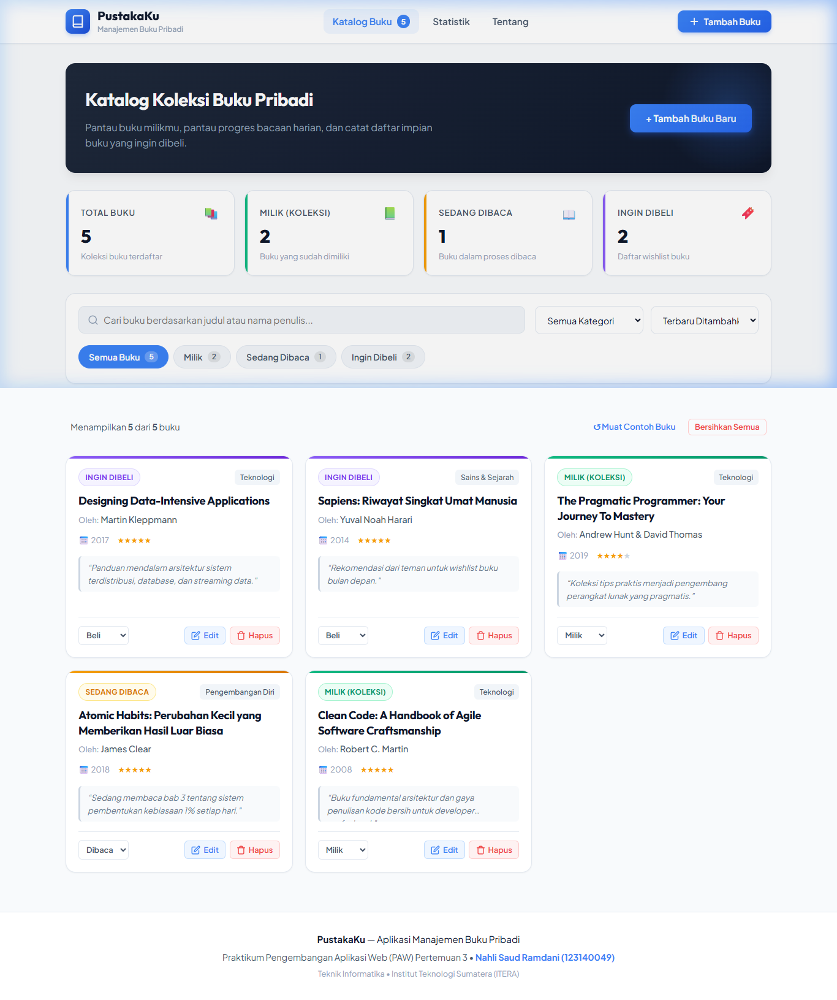
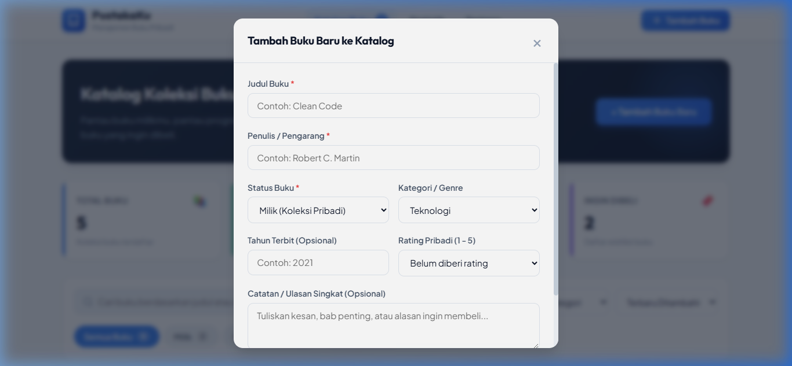
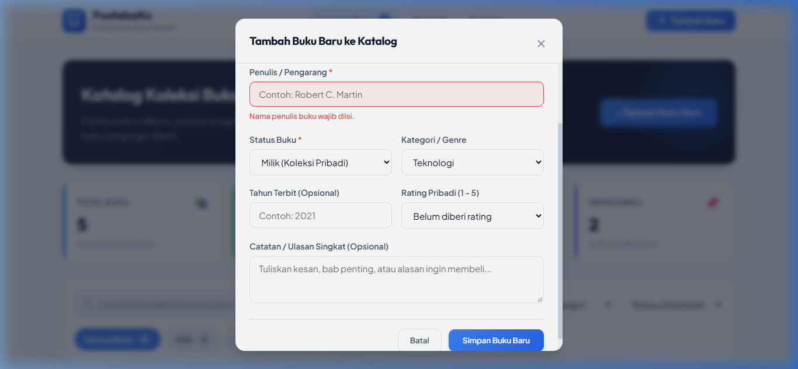
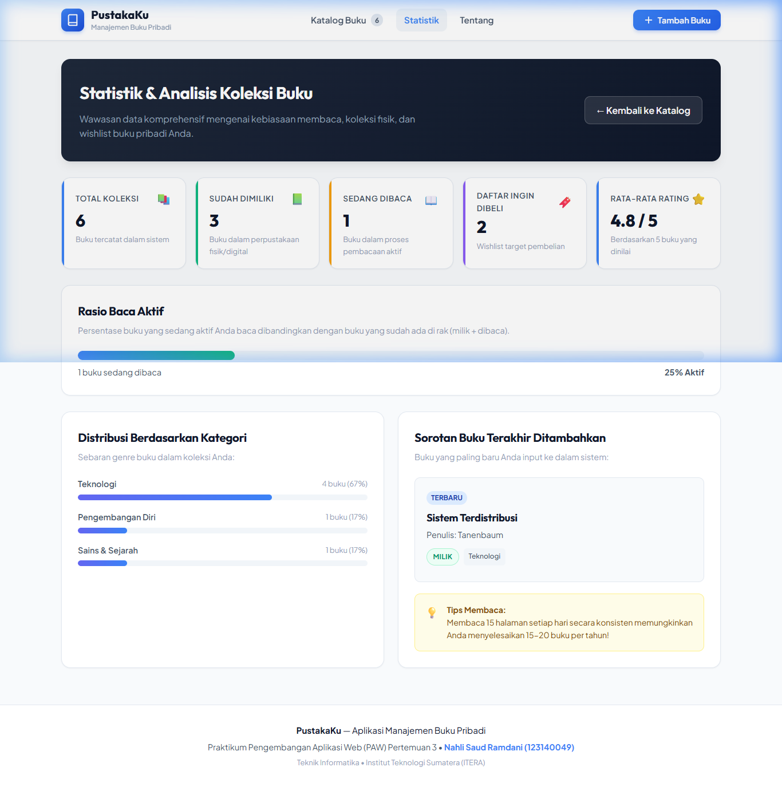
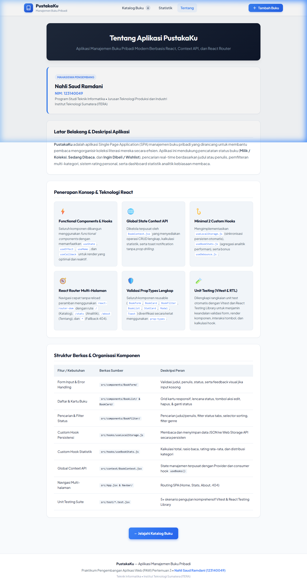
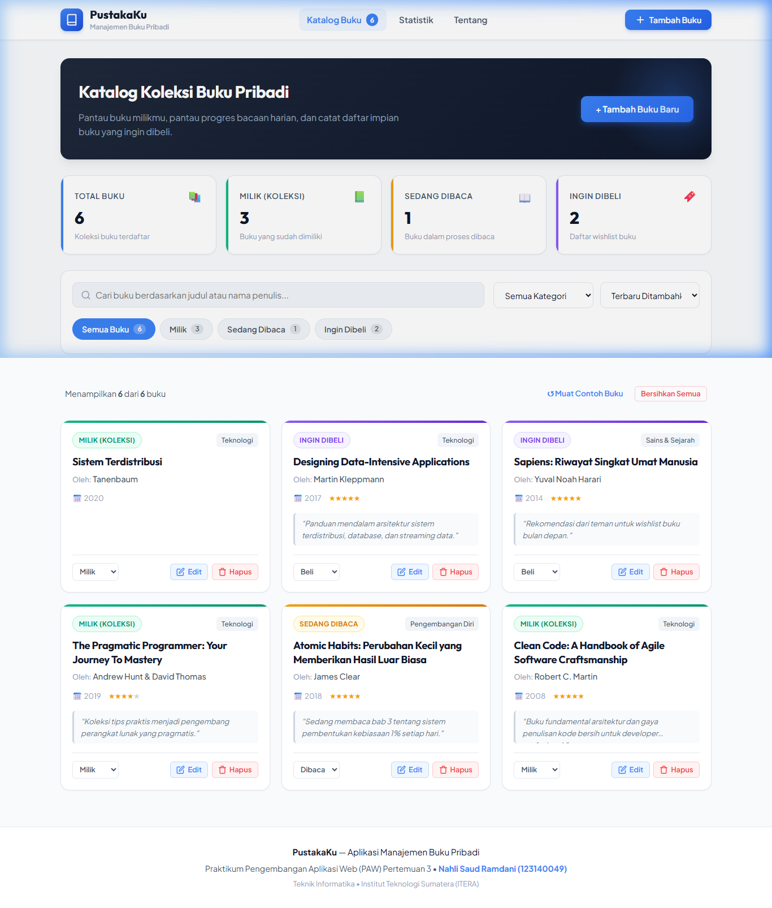

# Tugas Praktikum Pengembangan Aplikasi Web (PAW) - Pertemuan 3
## PustakaKu: Aplikasi Manajemen Buku Pribadi Modern

Aplikasi Web **PustakaKu** adalah platform Single Page Application (SPA) manajemen buku pribadi yang dirancang secara komprehensif untuk membantu pembaca mencatat, mengorganisir, dan menganalisis buku-buku yang **dimiliki (koleksi pribadi)**, **sedang dibaca**, atau **ingin dibeli (wishlist)**. 

Aplikasi ini dibangun menggunakan arsitektur modern **React 19**, **Vite**, **Context API** untuk state management terpusat, **React Router** untuk navigasi multi-halaman tanpa reload, **Custom Hooks** reusable, validasi tipe data ketat menggunakan **PropTypes**, penanganan kesalahan (*error handling*) interaktif dengan umpan balik visual, serta pengujian otomatis (*unit testing*) menggunakan **Vitest** dan **React Testing Library (RTL)**.

---

### Data Mahasiswa
- **Nama** : Nahli Saud Ramdani
- **NIM** : 123140049
- **Kelas Praktikum** : RA
- **Program Studi** : Teknik Informatika
- **Mata Kuliah** : Praktikum Pengembangan Aplikasi Web (PAW)
- **Institusi** : Institut Teknologi Sumatera (ITERA)

---

### Daftar Isi
1. [Deskripsi & Fitur Utama Aplikasi](#deskripsi--fitur-utama-aplikasi)
2. [Tangkapan Layar Antarmuka Aplikasi (Screenshots)](#tangkapan-layar-antarmuka-aplikasi-screenshots)
3. [Arsitektur & Konsep React yang Diterapkan](#arsitektur--konsep-react-yang-diterapkan)
4. [Struktur Direktori Proyek](#struktur-direktori-proyek)
5. [Instruksi Instalasi & Menjalankan Aplikasi](#instruksi-instalasi--menjalankan-aplikasi)
6. [Laporan Hasil Eksekusi Unit Test (Vitest & RTL)](#laporan-hasil-eksekusi-unit-test-vitest--rtl)
7. [Dokumentasi Pengerjaan Modul Latihan 1 - 6](#dokumentasi-pengerjaan-modul-latihan-1---6)

---

### Deskripsi & Fitur Utama Aplikasi

#### 1. Manajemen Data Buku (Full CRUD)
- **Tambah Buku Baru (Create)**: Formulir modal dialog terintegrasi dengan validasi ketat. Pengguna dapat menginput judul buku, nama penulis, status buku, kategori/genre, tahun terbit, rating bintang pribadi (1-5), dan catatan singkat.
- **Daftar Buku Responsif (Read)**: Menampilkan kartu buku (*BookCard*) dalam grid adaptif lengkap dengan lencana status berwarna kontras, indikator genre, tahun terbit, bintang ulasan, dan kutipan catatan.
- **Edit Buku (Update)**: Pengguna dapat mengklik tombol "Edit" pada kartu buku mana pun untuk memuat data sebelumnya ke dalam form modal dan memperbarui informasi buku.
- **Hapus Buku Aman (Delete)**: Dilengkapi modal konfirmasi keamanan bertingkat sebelum buku benar-benar dihapus dari penyimpanan untuk mencegah ketidaksengajaan.
- **Pintasan Cepat Ubah Status**: Pengguna dapat mengubah status buku (*Milik* ⇄ *Dibaca* ⇄ *Beli*) secara instan melalui dropdown selector pada footer setiap kartu buku.

#### 2. Pencarian & Pemfilteran Canggih
- **Pencarian Real-Time**: Pencarian instan (*case-insensitive*) yang mencocokkan kata kunci baik pada **Judul Buku** maupun **Nama Penulis** dengan optimasi custom hook `useDebounce`.
- **Tab Filter Status**: Filter sekali klik untuk mengisolasi buku berdasarkan status:
  - 📚 **Semua Buku**: Menampilkan seluruh koleksi yang tersimpan.
  - 📗 **Milik (Koleksi Pribadi)**: Buku yang telah dimiliki secara fisik maupun digital.
  - 📖 **Sedang Dibaca**: Buku yang sedang aktif dibaca pengguna saat ini.
  - 🔖 **Ingin Dibeli**: Daftar *wishlist* buku target belanja literasi.
- **Filter Kategori / Genre**: Menyaring buku berdasarkan topik (Teknologi, Pengembangan Diri, Sains & Sejarah, Fiksi & Sastra, Bisnis, Filsafat, Komik, dll.).
- **Pengurutan Fleksibel (Sorting)**: Mengurutkan buku berdasarkan:
  - Terbaru Ditambahkan
  - Judul (A - Z) & (Z - A)
  - Tahun Terbit (Terbaru & Terlama)
  - Rating Tertinggi

#### 3. Dasbor Analitik & Wawasan Literasi (`/stats`)
- Ringkasan metrik total koleksi, jumlah buku per status, dan rata-rata rating pembaca.
- **Bilah Rasio Baca Aktif**: Menghitung persentase dinamis buku yang sedang dibaca dibandingkan dengan total buku yang ada di rak koleksi.
- **Visualisasi Sebaran Genre**: Bilah kemajuan grafis (*progress bar*) yang memetakan persentase komposisi kategori buku.
- **Sorotan Buku Terbaru**: Kartu *spotlight* yang otomatis menampilkan detail buku yang paling akhir ditambahkan.
- **Tips Literasi**: Tips kebiasaan membaca harian untuk mendorong produktivitas.

#### 4. Notifikasi Toast & Feedback Visual Interaktif
- Setiap aksi tambah, ubah, hapus, dan perubahan status memicu notifikasi visual *Toast* dengan animasi *slide-in* yang ramah pengguna.
- Dilengkapi fitur pemulihan contoh data (*Load Sample Data*) dan pembersihan total (*Clear All Books*).

---

### Tangkapan Layar Antarmuka Aplikasi (Screenshots)

Berikut adalah dokumentasi hasil tangkapan layar antarmuka aplikasi **PustakaKu**:

#### 1. Halaman Utama Katalog Buku (Beranda)

*Gambar 1: Tampilan beranda utama menampilkan hero banner, kartu metrik statistik, bilah pencarian & filter status, serta grid kartu buku.*

#### 2. Modal Formulir Tambah Buku Baru

*Gambar 2: Modal dialog interaktif untuk menambahkan buku baru ke dalam katalog perpustakaan pribadi.*

#### 3. Penanganan Kesalahan Input Formulir (Error Handling)

*Gambar 3: Umpan balik visual interaktif dengan border merah dan pesan deskriptif ketika input judul atau penulis tidak memenuhi kriteria.*

#### 4. Halaman Statistik & Analisis Koleksi (`/stats`)

*Gambar 4: Analisis data koleksi buku mencakup rasio baca aktif, sebaran persentase kategori, dan sorotan buku terbaru.*

#### 5. Halaman Profil Pengembang & Panduan Teknis (`/about`)

*Gambar 5: Informasi identitas mahasiswa pengembang dan pemetaan konsep React yang diimplementasikan.*

#### 6. Hasil Pembaruan Data Buku

*Gambar 6: Katalog buku setelah buku baru berhasil ditambahkan dan notifikasi toast sukses muncul.*

---

### Arsitektur & Konsep React yang Diterapkan

| Konsep React | Implementasi Berkas | Penjelasan & Rationale |
| :--- | :--- | :--- |
| **Functional Components & Hooks** | Seluruh berkas di `src/components/` & `src/pages/` | Menggunakan paradigma modern functional component dengan `useState`, `useEffect`, `useMemo`, dan `useCallback`. |
| **Global State Context API** | `src/context/BookContext.jsx` | Mengeliminasi *prop drilling* dengan menyediakan state global untuk operasi CRUD buku, analitik statistik, dan notifikasi toast. |
| **Custom Hook Persistensi** | `src/hooks/useLocalStorage.js` | Mengabstraksi sinkronisasi data ke browser `localStorage` dengan *lazy initialization* dan penanganan *error parsing*. |
| **Custom Hook Agregasi Analitik** | `src/hooks/useBookStats.js` | Menghitung total buku, jumlah buku per status, rasio baca aktif, dan sebaran genre menggunakan `useMemo` untuk efisiensi komputasi. |
| **Custom Hook Debounce** | `src/hooks/useDebounce.js` | Mengoptimalkan pencarian teks *real-time* agar tidak memicu re-render berlebihan di setiap ketukan keyboard pengguna. |
| **Routing Multi-Halaman SPA** | `src/App.jsx` (`react-router-dom`) | Navigasi kilat tanpa kedipan reload untuk rute `/` (Katalog), `/stats` (Analitik), `/about` (Tentang), dan `*` (Fallback 404). |
| **Validasi PropTypes** | Seluruh komponen di `src/components/` | Menjamin keandalan tipe data (*type safety*) pada setiap props yang diterima komponen. |
| **Error Handling & Feedback Visual** | `src/components/BookForm/BookForm.jsx` | Validasi kolom wajib isi (judul min 2 karakter, penulis min 2 karakter, rentang tahun valid) dengan status visual merah. |
| **Komponen Reusable Berbingkai** | `src/components/Modal/`, `BookCard/`, `StatCard/` | Komponen modular yang dapat dipakai ulang secara konsisten di berbagai bagian aplikasi. |

---

### Struktur Direktori Proyek

```
NahliSaudRamdani_123140049_pertemuan3/
├── Modul/                             # Workspace Latihan Modul 1 - 6 (Terpisah & Mandiri)
│   ├── src/
│   │   ├── components/                # Header, TaskItem, TaskForm, Navbar, Card
│   │   ├── pages/                     # Home, About, NotFound (404)
│   │   ├── hooks/                     # useLocalStorage.js, useWindowSize.js
│   │   ├── context/                   # TaskContext.jsx (Global State)
│   │   ├── App.jsx & App.css
│   │   └── main.jsx
│   ├── package.json
│   ├── vite.config.js
│   └── README.md                      # Dokumentasi komprehensif pengerjaan Modul 1 - 6
├── screenshots/                       # Tangkapan layar antarmuka & dokumentasi
│   ├── 1_katalog_buku.png
│   ├── 2_modal_tambah_buku.png
│   ├── 3_validasi_error_handling.png
│   ├── 4_halaman_statistik.png
│   ├── 5_halaman_tentang.png
│   └── 6_katalog_setelah_tambah.png
├── src/                               # Source Code Utama Proyek Tugas Manajemen Buku
│   ├── components/
│   │   ├── BookCard/                  # Kartu buku individual (Badge status, Rating, Aksi)
│   │   ├── BookFilter/                # Pencarian, Tabs Status, Filter Kategori, Sorting
│   │   ├── BookForm/                  # Formulir Tambah/Edit dengan Error Handling
│   │   ├── BookList/                  # Grid koleksi kartu buku & Tampilan Empty State
│   │   ├── Modal/                     # Dialog modal reusable (Edit & Hapus)
│   │   ├── Navbar/                    # Navigasi sticky, brand logo, hitungan buku
│   │   ├── StatCard/                  # Kartu metrik analitik dengan variasi warna
│   │   └── Toast/                     # Notifikasi melayang aksi pengguna
│   ├── context/
│   │   └── BookContext.jsx            # Provider global CRUD & state buku
│   ├── hooks/
│   │   ├── useBookStats.js            # Custom Hook analitik & rasio baca
│   │   ├── useDebounce.js             # Custom Hook delay pencarian
│   │   └── useLocalStorage.js         # Custom Hook persistensi Web Storage
│   ├── pages/
│   │   ├── About/                     # Halaman Tentang & Profil Mahasiswa
│   │   ├── Home/                      # Halaman Utama Katalog Buku
│   │   ├── NotFound/                  # Halaman Fallback 404
│   │   └── Stats/                     # Halaman Analisis Statistik Buku
│   ├── test/                          # Unit Testing Suite (Vitest & RTL)
│   │   ├── setup.js                   # Konfigurasi jest-dom matchers
│   │   ├── BookCard.test.jsx          # Test interaksi kartu buku & tombol aksi
│   │   ├── BookFilter.test.jsx        # Test input pencarian & filter tabs
│   │   ├── BookForm.test.jsx          # Test validasi form & submit callback
│   │   ├── BookList.test.jsx          # Test render grid & empty state
│   │   └── useBookStats.test.js       # Test komputasi statistik custom hook
│   ├── App.css
│   ├── App.jsx                        # Komponen Root & Routing
│   ├── index.css                      # Design system, CSS variables, typography
│   └── main.jsx                       # Entry point React DOM
├── index.html
├── package.json
├── vite.config.js                     # Konfigurasi Vite & Vitest (JSDOM environment)
└── README.md
```

---

### Instruksi Instalasi & Menjalankan Aplikasi

#### Prasyarat Sistem
Pastikan Node.js dan npm telah terpasang pada komputer Anda:
```bash
node --version  # v18.0.0 atau lebih baru
npm --version   # v9.0.0 atau lebih baru
```

#### Langkah Menjalankan Proyek Tugas (PustakaKu)
1. Buka terminal dan masuk ke direktori utama tugas:
   ```bash
   cd "d:\S7.1\MKS7\Praktikum PAW\NahliSaudRamdani_123140049_pertemuan3"
   ```

2. Pasang seluruh dependensi proyek (jika belum terpasang):
   ```bash
   npm install
   ```

3. Jalankan server pengembang (*development server*):
   ```bash
   npm run dev
   ```

4. Akses aplikasi melalui tautan yang muncul di terminal (biasanya `http://localhost:5173/`).

5. Untuk membangun bundle produksi (*production build*):
   ```bash
   npm run build
   ```

---

### Laporan Hasil Eksekusi Unit Test (Vitest & RTL)

Pengujian otomatis dilakukan menggunakan **Vitest** dan **React Testing Library** yang mensimulasikan interaksi pengguna pada lingkungan DOM virtual (*JSDOM*).

#### Perintah Menjalankan Unit Test
```bash
npm test
```

#### Hasil Eksekusi di Terminal:
```
> nahlisaudramdani-123140049-pertemuan3@0.0.0 test
> vitest run

 RUN  v5.0.5 D:/S7.1/MKS7/Praktikum PAW/NahliSaudRamdani_123140049_pertemuan3

 ✓ src/test/BookFilter.test.jsx (3 tests) 637ms
   ✓ Komponen BookFilter (Pencarian & Pemfilteran) (3)
     ✓ merender input pencarian dan memicu callback onSearchChange saat mengetik
     ✓ memicu callback onStatusChange saat tab status diklik
     ✓ memicu callback onCategoryChange saat dropdown kategori berubah
 ✓ src/test/BookCard.test.jsx (4 tests) 948ms
   ✓ Komponen BookCard (Kartu Buku Reusable) (4)
     ✓ merender judul buku, nama penulis, dan status lencana dengan tepat
     ✓ memanggil onEdit saat tombol Edit diklik
     ✓ memanggil onDelete dengan ID buku saat tombol Hapus diklik
     ✓ memanggil onStatusChange saat dropdown status cepat diubah
 ✓ src/test/BookForm.test.jsx (4 tests) 1269ms
   ✓ Komponen BookForm (Validasi & Error Handling) (4)
     ✓ menampilkan pesan error validasi ketika disubmit dalam keadaan kosong
     ✓ menampilkan pesan error jika judul buku kurang dari 2 karakter
     ✓ berhasil memanggil onSubmit dengan data valid saat form diisi dengan benar
     ✓ memanggil onCancel ketika tombol Batal diklik
 ✓ src/test/useBookStats.test.js (4 tests) 100ms
   ✓ Custom Hook useBookStats (Agregasi Data & Analitik) (4)
     ✓ menghitung total dan agregasi status buku dengan benar
     ✓ menghitung rasio baca aktif dengan benar
     ✓ menghitung rata-rata rating hanya dari buku yang memiliki rating
     ✓ mengidentifikasi buku terbaru berdasarkan createdAt
 ✓ src/test/BookList.test.jsx (3 tests) 673ms
   ✓ Komponen BookList (Koleksi Kartu & Status Kosong) (3)
     ✓ merender seluruh daftar kartu buku saat data tersedia
     ✓ merender tampilan empty state ketika daftar buku kosong karena filter
     ✓ merender ajakan tambah buku ketika sistem sama sekali belum memiliki buku

 Test Files  5 passed (5)
      Tests  18 passed (18)
   Start at  11:34:59
   Duration  82.18s
```

**Ringkasan Status Pengujian:**
- **Total Test Files**: 5 file pengujian (100% Lulus)
- **Total Unit Tests**: 18 skenario pengujian (100% Lulus)
- **Cakupan Pengujian**: Validasi formulir, umpan balik visual error, event handler pencarian & filter, interaksi kartu buku, kalkulasi statistik kustom hook, dan empty state.

---

### Dokumentasi Pengerjaan Modul Latihan 1 - 6

Seluruh materi latihan dari modul praktikum telah diselesaikan secara lengkap di dalam direktori `Modul/` dengan rincian berikut:

1. **Submodul 1 (Setup Project React)**:
   - Workspace modular dengan pemisahan `components`, `pages`, `hooks`, dan `context`.
   - **Latihan Mandiri 1**: Eksplorasi HMR dengan mengubah warna `.App-header` menjadi `#0d9488` pada `Modul/src/App.css`.
2. **Submodul 2 (Components & Props)**:
   - Pembuatan komponen `Header`, `TaskItem`, dan `TaskForm` dengan `PropTypes`.
   - **Latihan Mandiri 2**: Pembuatan komponen `Card` yang memanfaatkan `props.children` untuk membungkus form tugas.
3. **Submodul 3 (State Management & Hooks)**:
   - Pengelolaan state array tasks dengan immutability (`spread operator` & `filter`).
   - Sinkronisasi otomatis ke `localStorage` via `useEffect`.
   - **Latihan Mandiri 3**: Tombol "Hapus Semua Tugas" dengan konfirmasi dialog `window.confirm()`.
4. **Submodul 4 (Routing dengan React Router)**:
   - Integrasi `BrowserRouter`, `Navbar`, serta halaman `Home` dan `About`.
   - **Latihan Mandiri 4**: Pembuatan halaman `NotFound.jsx` (404) dengan fallback route `<Route path="*" element={<NotFound />} />`.
5. **Submodul 5 (Custom Hooks)**:
   - Implementasi `useLocalStorage.js` untuk manajemen penyimpanan lokal.
   - Implementasi `useWindowSize.js` untuk deteksi dimensi layar secara dinamis.
   - **Latihan Mandiri 5**: Menampilkan badge responsif ("Mode Layar Mobile" / "Mode Layar Desktop") berdasarkan ukuran viewport layar.
6. **Submodul 6 (Global State dengan Context API)**:
   - Pembuatan `TaskContext.jsx` dan custom consumer hook `useTasks()`.
   - **Latihan Mandiri 6**: Menampilkan ringkasan jumlah tugas yang tersimpan di sistem pada halaman `About.jsx` langsung melalui context.

Untuk panduan lengkap dan cara menjalankan proyek latihan modul, silakan baca [Modul/README.md](file:///d:/S7.1/MKS7/Praktikum%20PAW/NahliSaudRamdani_123140049_pertemuan3/Modul/README.md).
