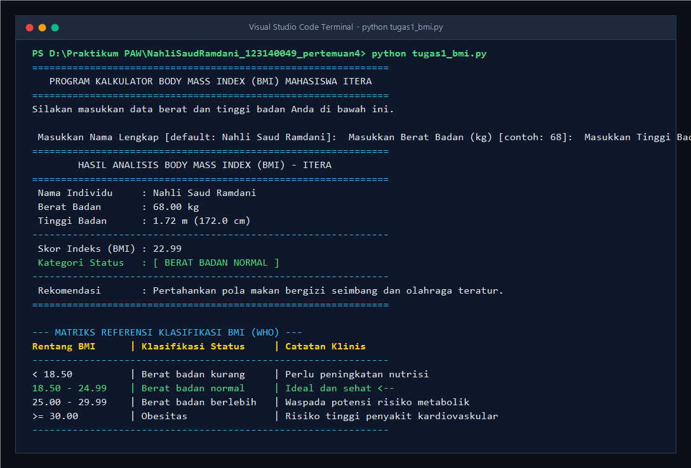
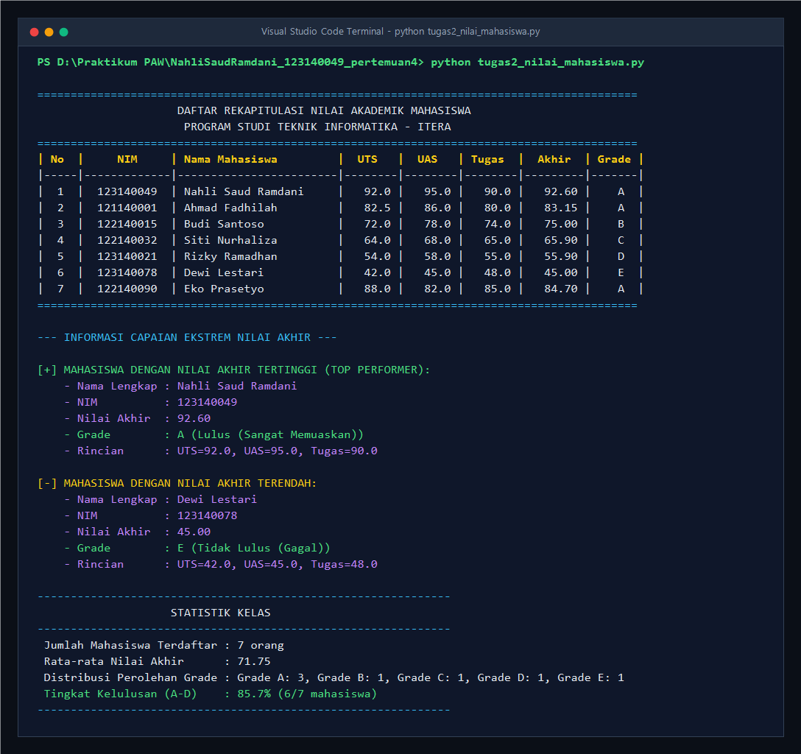
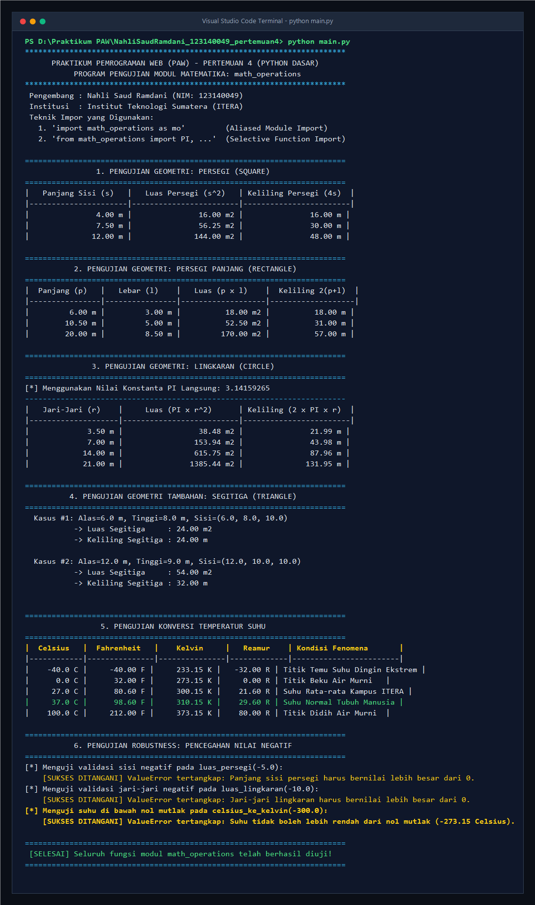
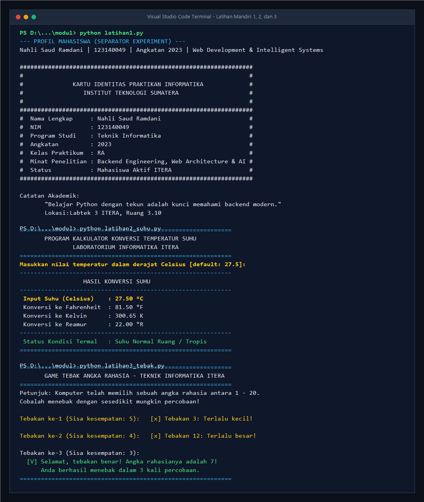
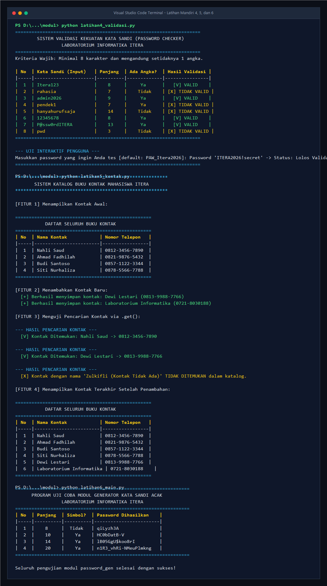

# Tugas Praktikum Pengembangan Aplikasi Web (PAW) - Pertemuan 4
## Dasar Pemrograman Python & Pemrograman Modular

Repositori ini memuat pengerjaan tugas dan latihan mandiri praktikum **Pertemuan 4: Python Dasar** pada mata kuliah **Praktikum Pengembangan Aplikasi Web (PAW)**, Program Studi Teknik Informatika, Institut Teknologi Sumatera (ITERA). Seluruh kode ditulis dengan mematuhi standar konvensi resmi **PEP 8**, dilengkapi anotasi tipe data (*type hinting*), dokumentasi *docstring* lengkap, penanganan kesalahan (*error handling*), serta penerapan modularitas kode bersih (*clean code*).

---

### Data Mahasiswa
- **Nama** : Nahli Saud Ramdani
- **NIM** : 123140049
- **Kelas Praktikum** : RA
- **Program Studi** : Teknik Informatika
- **Mata Kuliah** : Praktikum Pengembangan Aplikasi Web (PAW)
- **Institusi** : Institut Teknologi Sumatera (ITERA)

---

### Daftar Isi
1. [Struktur Direktori Proyek](#struktur-direktori-proyek)
2. [Deskripsi Program Tugas Utama](#deskripsi-program-tugas-utama)
   - [Tugas 1: Program Penghitung BMI Sederhana (`tugas1_bmi.py`)](#tugas-1-program-penghitung-bmi-sederhana-tugas1_bmipy)
   - [Tugas 2: Pengelolaan Data Nilai Mahasiswa (`tugas2_nilai_mahasiswa.py`)](#tugas-2-pengelolaan-data-nilai-mahasiswa-tugas2_nilai_mahasiswapy)
   - [Tugas 3: Modul Matematika & Program Pengujian (`math_operations.py` & `main.py`)](#tugas-3-modul-matematika--program-pengujian-math_operationspy--mainpy)
3. [Tangkapan Layar Hasil Eksekusi Program (Screenshots)](#tangkapan-layar-hasil-eksekusi-program-screenshots)
4. [Dokumentasi Pengerjaan Modul & Latihan Mandiri 1 - 6](#dokumentasi-pengerjaan-modul--latihan-mandiri-1---6)
5. [Panduan Menjalankan Program di Terminal](#panduan-menjalankan-program-di-terminal)
6. [Kepatuhan Standar PEP 8 & Filosofi Python](#kepatuhan-standar-pep-8--filosofi-python)

---

### Struktur Direktori Proyek

```text
NahliSaudRamdani_123140049_pertemuan4/
├── .gitignore                      # Berkas pengabaian artefak cache, bytecode, dan env
├── README.md                       # Laporan dokumentasi komprehensif praktikum
├── tugas1_bmi.py                   # [Tugas 1] Program kalkulator BMI & klasifikasi WHO
├── tugas2_nilai_mahasiswa.py       # [Tugas 2] Pengelolaan nilai mahasiswa, tabel, & analitik
├── math_operations.py              # [Tugas 3A] Modul kustom geometri, suhu, & konstanta
├── main.py                         # [Tugas 3B] Program utama pengujian multi-import modul
├── generate_screenshots.ps1        # Skrip otomatisasi penangkapan bukti terminal
├── screenshots/                    # Folder bukti tangkapan layar eksekusi program
│   ├── 1_tugas1_bmi.png
│   ├── 2_tugas2_nilai_mahasiswa.png
│   ├── 3_soal3_math_operations.png
│   ├── 4_modul_latihan_1_3.png
│   └── 5_modul_latihan_4_6.png
└── modul/                          # Folder materi & latihan mandiri modul praktikum
    ├── 01_pengenalan.py            # Materi 1: Pengenalan fungsi print(), sep, dan end
    ├── latihan1.py                 # Latihan 1: Identitas diri berbingkai & escape character
    ├── 02_variabel.py              # Materi 2: Variabel, tipe data, casting, & manipulasi string
    ├── latihan2_suhu.py            # Latihan 2: Kalkulator konversi suhu interaktif
    ├── 03_kendali.py               # Materi 3: Struktur kontrol if-elif-else, for, & while loop
    ├── latihan3_tebak.py           # Latihan 3: Game tebak angka rahasia interaktif
    ├── 04_fungsi.py                # Materi 4: Fungsi modular, default args, *args, **kwargs, lambda
    ├── latihan4_validasi.py        # Latihan 4: Fungsi validator kekuatan password
    ├── 05_struktur_data.py         # Materi 5: List comprehension, tuple, dict, & set
    ├── latihan5_kontak.py          # Latihan 5: Katalog manajemen buku kontak
    ├── kalkulator_lib.py           # Materi 6: Modul helper kalkulator aritmatika
    ├── 06_modul_app.py             # Materi 6: Standard library (math, random, datetime)
    ├── password_gen.py             # Latihan 6: Modul generator password acak
    └── latihan6_main.py            # Latihan 6: Skrip pengujian modul password acak
```

---

### Deskripsi Program Tugas Utama

#### Tugas 1: Program Penghitung BMI Sederhana (`tugas1_bmi.py`)
- **Bobot Penilaian**: 30%
- **Deskripsi & Alur Kerja**:
  Program menghitung indeks massa tubuh (*Body Mass Index* / BMI) individu berdasarkan input berat badan (kg) dan tinggi badan (m atau cm). Program secara cerdas mendeteksi apabila pengguna menginput tinggi dalam satuan centimeter (> 3.0) dan mengonversinya secara otomatis ke satuan meter.
- **Formula Matematika**:
  $$\text{BMI} = \frac{\text{Berat Badan (kg)}}{\left(\text{Tinggi Badan (m)}\right)^2}$$
- **Klasifikasi Status Gizi Berdasarkan Standar WHO / Kemenkes RI**:
  - $\text{BMI} < 18.5$ : **Berat badan kurang** (*Underweight*)
  - $18.5 \le \text{BMI} < 25.0$ : **Berat badan normal** (*Normal weight*)
  - $25.0 \le \text{BMI} < 30.0$ : **Berat badan berlebih** (*Overweight*)
  - $\text{BMI} \ge 30.0$ : **Obesitas** (*Obese*)
- **Fitur Unggulan**:
  1. Penanganan kesalahan input (*ValueError* dan *EOFError*) yang mencegah program mengalami *crash* saat menerima input non-numerik.
  2. Format output angka desimal presisi 2 angka di belakang koma (`{bmi:.2f}`).
  3. Kartu hasil visual berbingkai konsol yang dilengkapi rekomendasi pola hidup sehat serta tabel referensi matriks WHO lengkap dengan indikator penunjuk aktif (`<--`).

---

#### Tugas 2: Pengelolaan Data Nilai Mahasiswa (`tugas2_nilai_mahasiswa.py`)
- **Bobot Penilaian**: 40%
- **Deskripsi & Alur Kerja**:
  Program memproses data akademik mahasiswa Teknik Informatika ITERA yang disimpan dalam struktur data koleksi `List of Dictionaries`. Setiap entri mahasiswa menyimpan data: `nama`, `nim`, `nilai_uts`, `nilai_uas`, dan `nilai_tugas`. Program kemudian menghitung Nilai Akhir secara terbobot dan memetakan predikat grade akademik huruf beserta status kelulusan.
- **Formula Pembobotan Nilai Akhir**:
  $$\text{Nilai Akhir} = (30\% \times \text{UTS}) + (40\% \times \text{UAS}) + (30\% \times \text{Tugas})$$
- **Kriteria Konversi Grade**:
  - $\text{Nilai Akhir} \ge 80.0$ : **Grade A** (Lulus - Sangat Memuaskan)
  - $70.0 \le \text{Nilai Akhir} < 80.0$ : **Grade B** (Lulus - Memuaskan)
  - $60.0 \le \text{Nilai Akhir} < 70.0$ : **Grade C** (Lulus - Cukup)
  - $50.0 \le \text{Nilai Akhir} < 60.0$ : **Grade D** (Lulus Bersyarat - Kurang)
  - $\text{Nilai Akhir} < 50.0$ : **Grade E** (Tidak Lulus - Gagal)
- **Fitur Unggulan**:
  1. **Tabel Rekapitulasi Rapi**: Menggunakan pemformatan *f-string* dengan perataan kolom rata kiri, tengah, dan kanan yang simetris tanpa dependensi eksternal.
  2. **Deteksi Nilai Ekstrem Otomatis**: Memanfaatkan fungsi *built-in* `max()` dan `min()` dengan ekspresi anonim `key=lambda m: m["nilai_akhir"]` untuk mengidentifikasi mahasiswa dengan pencapaian tertinggi (*Top Performer*) dan mahasiswa dengan nilai terendah secara akurat.
  3. **Analitik Statistik Kelas**: Menampilkan rata-rata nilai kelas, sebaran frekuensi perolehan tiap grade (A - E), serta persentase rasio kelulusan kelas.

---

#### Tugas 3: Modul Matematika & Program Pengujian (`math_operations.py` & `main.py`)
- **Bobot Penilaian**: 30%
- **Deskripsi Arsitektur**:
  Menerapkan prinsip arsitektur modular dengan memisahkan pustaka logika fungsi (*library module*) ke dalam berkas `math_operations.py` dan berkas eksekutor pengujian (*driver application*) ke dalam berkas `main.py`.
- **Fitur Modul `math_operations.py`**:
  - **Konstanta Matematika**: `PI = 3.141592653589793` dan `EULER = 2.718281828459045`.
  - **Fungsi Geometri Bidang Datar**:
    * Persegi: `luas_persegi(sisi)` dan `keliling_persegi(sisi)`.
    * Persegi Panjang: `luas_persegi_panjang(panjang, lebar)` dan `keliling_persegi_panjang(panjang, lebar)`.
    * Lingkaran: `luas_lingkaran(jari_jari)` dan `keliling_lingkaran(jari_jari)`.
    * Segitiga (fitur pendukung): `luas_segitiga(alas, tinggi)` dan `keliling_segitiga(sisi_a, sisi_b, sisi_c)`.
  - **Fungsi Konversi Skala Suhu**:
    * `celsius_ke_fahrenheit(celsius)`: $F = (C \times 9/5) + 32$
    * `celsius_ke_kelvin(celsius)`: $K = C + 273.15$
    * `celsius_ke_reamur(celsius)`: $R = C \times 4/5$
    * `fahrenheit_ke_celsius(fahrenheit)` dan `kelvin_ke_celsius(kelvin)`
  - **Pencegahan Error (*Guard Clauses*)**: Memvalidasi dimensi bernilai positif ($> 0$) dan batasan suhu fisik di atas nol mutlak ($-273.15^\circ\text{C}$).
  - **Idiom Pengujian Mandiri**: Dilengkapi blok `if __name__ == "__main__":` sehingga pengujian internal modul tidak dieksekusi saat diimpor oleh berkas lain.
- **Implementasi Program Utama `main.py`**:
  Menerapkan **minimal 2 cara berbeda** dalam mengimpor modul:
  1. **Cara 1 (Aliased Module Import)**: `import math_operations as mo` — Digunakan untuk memanggil fungsi-fungsi geometri dengan *namespace* bersih `mo.nama_fungsi()`.
  2. **Cara 2 (Selective Function & Constant Import)**: `from math_operations import PI, luas_lingkaran, keliling_lingkaran, celsius_ke_fahrenheit, celsius_ke_kelvin, celsius_ke_reamur` — Mengimpor konstanta dan fungsi spesifik langsung ke dalam ruang lingkup lokal.
  3. Menguji seluruh fungsi dengan berbagai variasi angka uji dan menyajikan hasilnya dalam tabel konsol yang terstruktur.

---

### Tangkapan Layar Hasil Eksekusi Program (Screenshots)

Berikut adalah dokumentasi tangkapan layar terminal hasil pengujian eksekusi program:

#### 1. Hasil Eksekusi Tugas 1: Kalkulator BMI (`tugas1_bmi.py`)

*Gambar 1: Tampilan terminal saat mengeksekusi program kalkulator BMI dengan input nama, berat, tinggi, penentuan kategori status WHO, dan tabel matriks klasifikasi.*

---

#### 2. Hasil Eksekusi Tugas 2: Pengelolaan Nilai Mahasiswa (`tugas2_nilai_mahasiswa.py`)

*Gambar 2: Tampilan tabel rekapitulasi nilai mahasiswa ITERA, perolehan grade A-E, penentuan mahasiswa peraih nilai tertinggi/terendah, dan ringkasan statistik kelas.*

---

#### 3. Hasil Eksekusi Tugas 3: Pengujian Modul Matematika (`main.py`)

*Gambar 3: Tampilan eksekusi program utama `main.py` yang mendemonstrasikan pengujian fungsi geometri, konversi suhu, konstanta PI, dan uji ketahanan (robustness) modul `math_operations.py`.*

---

#### 4. Hasil Eksekusi Latihan Mandiri 1, 2, dan 3

*Gambar 4: Demonstrasi eksekusi Latihan 1 (kartu identitas print), Latihan 2 (konversi suhu interaktif), dan Latihan 3 (game tebak angka rahasia).*

---

#### 5. Hasil Eksekusi Latihan Mandiri 4, 5, dan 6

*Gambar 5: Demonstrasi eksekusi Latihan 4 (validator password), Latihan 5 (katalog kontak dictionary), dan Latihan 6 (modul generator password acak).*

---

### Dokumentasi Pengerjaan Modul & Latihan Mandiri 1 - 6

Seluruh latihan mandiri yang tercantum pada panduan praktikum telah diselesaikan di dalam folder [`modul/`](file:///d:/S7.1/MKS7/Praktikum%20PAW/NahliSaudRamdani_123140049_pertemuan4/modul):

| Berkas Latihan | Pokok Bahasan | Ringkasan Solusi & Logika Implementasi |
| :--- | :--- | :--- |
| **`latihan1.py`** | Identitas Diri & Print | Mencetak profil diri menggunakan parameter `sep=" \| "` serta merancang kartu identitas berbingkai karakter pagar (`#`) dengan memanfaatkan *escape character* `\n` dan `\t`. |
| **`latihan2_suhu.py`** | Konversi Suhu Interaktif | Menerima input suhu Celsius dari pengguna melalui `float(input())`, menghitung konversi ke skala Fahrenheit ($F = C \times 9/5 + 32$), Kelvin ($K = C + 273.15$), dan Reamur, lalu mencetaknya dengan format `f-string` 2 angka desimal. |
| **`latihan3_tebak.py`** | Loop & Percabangan | Membangun game tebak angka interaktif berbasis perulangan `while` dan evaluasi bertingkat (`Terlalu kecil!`, `Terlalu besar!`). Loop berhenti seketika menggunakan perintah `break` saat tebakan bernilai tepat atau ketika batas percobaan habis. |
| **`latihan4_validasi.py`** | Modularitas Fungsi & String | Mendefinisikan fungsi `validasi_password(password)` yang memeriksa panjang karakter minimal 8 serta keberadaan setidaknya satu karakter digit angka menggunakan fungsi `any()` dan *generator expression*. |
| **`latihan5_kontak.py`** | Dictionary & Pencarian | Mengelola katalog buku telepon berbasis `dict`. Dilengkapi fungsi penambahan kontak baru, pencarian nomor telepon menggunakan method `.get()` untuk mencegah *KeyError*, serta iterasi seluruh kontak via `.items()`. |
| **`password_gen.py` & `latihan6_main.py`** | Pembuatan & Impor Modul | Modul `password_gen.py` menyediakan fungsi `buat_password_acak(panjang=8)` yang mengombinasikan modul pustaka standar `random` (`random.choice`, `random.shuffle`) dan modul `string` (`ascii_letters`, `digits`). Diuji melalui `latihan6_main.py`. |

---

### Panduan Menjalankan Program di Terminal

Pastikan runtime engine Python (versi 3.10 ke atas) telah terpasang di sistem operasi Anda.

#### 1. Masuk ke Direktori Pertemuan 4
Buka aplikasi terminal (PowerShell, Command Prompt, atau Terminal VS Code), lalu arahkan direktori aktif:
```bash
cd "d:\S7.1\MKS7\Praktikum PAW\NahliSaudRamdani_123140049_pertemuan4"
```

#### 2. Menjalankan Berkas Tugas Utama
- **Menjalankan Tugas 1 (Kalkulator BMI)**:
  ```bash
  python tugas1_bmi.py
  ```
- **Menjalankan Tugas 2 (Pengelolaan Nilai Mahasiswa)**:
  ```bash
  python tugas2_nilai_mahasiswa.py
  ```
- **Menjalankan Pengujian Mandiri Modul Matematika**:
  ```bash
  python math_operations.py
  ```
- **Menjalankan Tugas 3 (Program Utama Pengujian Modul)**:
  ```bash
  python main.py
  ```

#### 3. Menjalankan Latihan Mandiri di Folder `modul/`
Arahkan terminal ke dalam folder modul:
```bash
cd modul

# Menjalankan Latihan 1:
python latihan1.py

# Menjalankan Latihan 2:
python latihan2_suhu.py

# Menjalankan Latihan 3:
python latihan3_tebak.py

# Menjalankan Latihan 4:
python latihan4_validasi.py

# Menjalankan Latihan 5:
python latihan5_kontak.py

# Menjalankan Latihan 6 (Modul Password):
python latihan6_main.py
```

---

### Kepatuhan Standar PEP 8 & Filosofi Python

Seluruh kode dalam repositori ini disusun dengan mematuhi pedoman baku **PEP 8 (Python Enhancement Proposal 8)**:
1. **Indentasi Konsisten**: Menggunakan tepat 4 spasi untuk setiap tingkatan blok kode (tanpa percampuran tab dan spasi).
2. **Konvensi Penamaan (*Naming Conventions*)**:
   - Variabel dan fungsi menggunakan gaya **`snake_case`** (contoh: `hitung_nilai_akhir`, `daftar_mahasiswa`).
   - Konstanta menggunakan huruf kapital penuh **`UPPER_SNAKE_CASE`** (contoh: `PI`, `DAFTAR_MAHASISWA`).
3. **Dokumentasi Terstruktur (*Docstrings*)**: Setiap modul dan fungsi dilengkapi dengan penjelasan parameter input, nilai kembalian (*return value*), serta potensi *exception* yang dapat dimunculkan.
4. **Penerapan *The Zen of Python***:
   - *"Explicit is better than implicit"*: Menggunakan *type hints* eksplisit (`float`, `str`, `List[Dict]`) untuk memperjelas kontrak fungsi.
   - *"Simple is better than complex"*: Menyelesaikan permasalahan logika dengan algoritma yang lugas, mudah dibaca (*readable*), dan mudah dirawat (*maintainable*).

